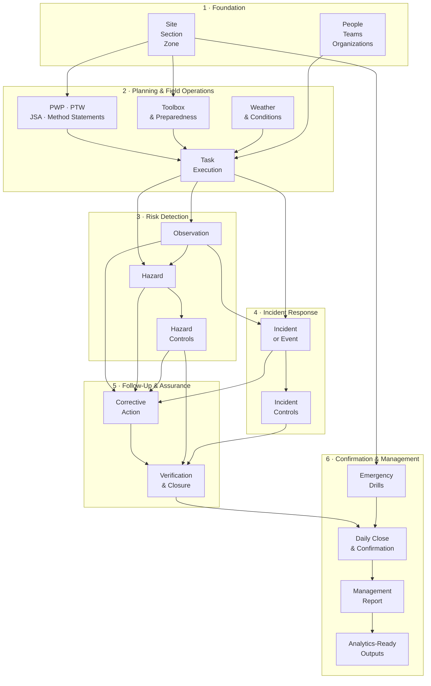

# 🦺 HSE Risk Intelligence — Project Portfolio

## Operational HSE Decision-Support Platform

**HSE Risk Intelligence** is a PostgreSQL + Streamlit decision-support platform for structuring operational HSE information into a connected, traceable workflow.

The system brings together:

- site, section, zone, organization, team, and personnel context
- work planning and task execution
- PTW, JSA, Method Statement, and Planned Work Package records
- toolbox meetings and workforce participation
- weather and operational conditions
- observations, hazards, and controls
- incidents / events and incident controls
- corrective actions and verification
- emergency preparedness drills
- daily confirmation and management reporting
- data structures designed for future KPI and longitudinal analysis 

The objective is not to automate safety decisions.

The system is designed to help people **capture operational evidence consistently, preserve relationships between records, identify what requires attention, and support defensible management review.**

---

## 🌍 Why I Built It

Operational HSE information is often fragmented across:

- daily reports
- spreadsheets
- PTWs and JSAs
- toolbox records
- hazard registers
- incident forms
- corrective-action trackers
- personnel records

HSE Risk Intelligence explores how these records can be represented as a connected operational data system rather than independent documents.

The project is informed by real HSE field-reporting experience while using generalized, anonymized, and portfolio-safe data structures.

---

## 🔐 Data Ethics, Governance & Portfolio Use

The database design is informed by field-derived HSE observations, daily safety reporting, PPE/control verification, work-planning records, and operational oversight.

It is not a copy of a proprietary corporate database or internal software system.

For portfolio use:

- identifying worker information is anonymized or generalized
- organizations and site details are abstracted where appropriate
- PTW, JSA, and related identifiers are generalized
- proprietary forms and templates are not reproduced
- risk classifications and lookup structures are implemented independently

The aim is to preserve realistic operational relationships without exposing confidential project information.

---

## 🧭 Version 1 — Current Scope

1 · Operational Foundation

The platform establishes context through:

- Sites
- Site Sections
- Zones
- Zone Models and lineage
- Phases
- Organizations
- Teams
- Personnel
- Personnel / organization history
- Application users and site access

2 · Planning & Field Operations

Version 1 supports:

- Planned Work Packages
- planned tasks
- Permit to Work records
- Job Safety Analyses
- Method Statements
- toolbox meetings
- attendance / personnel presence
- task execution
- PPE and control verification
- weather-assisted operational context

3 · Risk Detection & Controls

Operational records can capture and connect:

- observations
- hazards
- severity and probability classifications
- hazard controls
- control status
- control effectiveness
- hazard-library references
- planned versus newly identified hazards

Observations and hazards may be linked to task execution where appropriate, while the model also supports records that are not tied to a specific task.

4 · Incident / Event Management

- Incident architecture includes:
- incident / event records
- incident type and subtype
- actual and potential severity
- people involve
- assets involved
- external notifications
- attachments / external file references
- incident controls
- incident ↔ task relationships
- incident ↔ observation relationships
- incident link requests
- lifecycle / status history
- follow-up and investigation indicators

5 · Corrective Action & Assurance

Corrective actions can originate from operational sources including:

- observations
- hazards
- hazard controls
- incidents
- PTW / JSA context
- inspections / audits
- management concerns

The lifecycle supports assignment, due dates, status progression, implementation, verification, and controlled closure.

6 · Emergency Preparedness

Emergency Drill functionality supports:

- multiple drill categories
- participants
- operational location
- observations and lessons learned
- improvement areas
- follow-up drills
- links to tasks
- links to incidents
- links to observations
- links to hazards
- links to corrective actions
- Completed / Details Pending / Void lifecycle states

7 · Daily Confirmation & Reporting

Daily operations can be finalized through a controlled confirmation process.

Confirmed records are associated with a daily confirmation batch and an immutable management-report snapshot so that the final confirmed report can be retrieved without reconstructing it from subsequently changing operational records.

---

## 🎞️ How the Operational Workflow Connects

## 🔄 Conceptual Operational Risk Model

This is a conceptual model. The physical PostgreSQL implementation contains additional relationship, lifecycle, audit, lookup, approval, and history tables.

---

## 🧠 What “Risk Intelligence” Means Here

In Version 1, risk intelligence means connecting operational evidence so that a reviewer can understand:

- what work occurred
- where it occurred
- who was involved
- what conditions were present
- what was observed
- what hazards were identified
- what controls were implemented
- whether controls were reviewed
- whether an incident occurred
- what corrective follow-up remains
- what emergency-preparedness activities occurred
- what was ultimately confirmed in the daily management record

The platform remains human-guided. It supports decisions rather than replacing professional judgement.

---

## 🗄️ Database Architecture

The Version 1 database uses PostgreSQL schemas to separate responsibilities:

- lookup — controlled classifications and reference values
- core — sites, personnel, organizations, zones, hazard/control reference structures
- operations — operational workflows and transactional records
- security — users, roles, access, and approval infrastructure
- analytics — analytics-ready structures

The Layer 3 / Version 1 canonical database baseline has been rebuilt successfully from an empty PostgreSQL database and is maintained separately from historical development migrations.

Future schema changes are intended to be introduced as forward migrations rather than rewriting the frozen Version 1 baseline.

---

## 🧱 Technology

Application

- Python
- Streamlit

Database

- PostgreSQL
- psycopg2

Reporting

- structured daily management reports
- Word document generation

database-preserved confirmed report snapshots

Data / Analysis

- SQL
- pandas
- future KPI and longitudinal analytics

---

## 📂 Repository Structure

Repository organization may evolve as Version 1 is prepared for deployment, but the main areas include:

- `README.md` — Project overview, current Version 1 scope, architecture, and roadmap.
- `HOW_IT_WORKS.md` — Non-technical walkthrough of how operational information moves through the system.
- `Case_Study.md` — Project problem framing, architecture decisions, lessons learned, and decision-support use case.
- `/docs` — Public technical documentation, architecture diagrams, workflow explanations, and database design notes.
- `/images` — Architecture diagrams, animated workflow visuals, screenshots, and other documentation assets.

The database folder contains the canonical Version 1 baseline and subsequent migrations.

Secrets and production credentials are never committed to GitHub.

> **Note:** Core application code, database build scripts, migration files, and internal implementation modules are maintained privately. The public repository focuses on architecture, workflow design, documentation, selected outputs, and portfolio-safe technical explanations.

---

## 📖 Documentation

See:

- [**Operational Architecture**](docs/Operational_Architecture.md) — conceptual system flow
- [**HOW_IT_WORKS.md**](https://github.com/Euchie23/HSEQ_Risk_Intel/blob/main/HOW_IT_WORKS.md) — non-technical operational walkthrough
- [**Database Operations Manual**](https://github.com/Euchie23/HSEQ_Risk_Intel/blob/main/docs/Database_Operations_Manual.md) — database and workflow rules
- [**Database Canonical-Baseline Documentation**](docs/Database_Baseline_and_Migrations.md) — rebuild order and migration policy

---

## 🔭 Planned Version 2 Exploration

Version 2 is intended to explore how accumulated operational data can support more advanced risk-analysis capabilities.

Potential directions include:

- bow-tie-style hazard visualization
- barrier / control-health analysis
- scenario and preparedness simulation
- evidence-linked field photographs and documents using external object storage
- richer management dashboards
- longitudinal and cross-site risk patterns
- natural-language querying
- decision-support experimentation using historical operational evidence

These capabilities are planned research and development directions and are not represented as implemented Version 1 functionality.

---

## 🎯 Project Objective

The project demonstrates how operational HSE records can be transformed from disconnected documentation into a structured, auditable, relational decision-support system.

Its focus is:

**Operational usefulness → traceability → human-guided risk management → management-ready information.**

---

## 🧠 In One Sentence

HSE Risk Intelligence is a human-guided operational decision-support platform that connects work, observations, hazards, controls, incidents, corrective actions, preparedness, and confirmed reporting into a traceable PostgreSQL data model.

---

## 👥 Audience & Use Cases

- Site managers / HSE officers  
- Project engineers / supervisors  
- Executive leadership / management  
- Data analysts exploring operational trends  
- Consultants or auditors assessing HSE compliance  

---
## 📬 Get Involved

- 🐛 [Open an issue](https://github.com/Euchie23/HSEQ_Risk_Intel/issues) for feedback, bugs, or suggestions  
- ✉️ [Email me](mailto:euchiejnpierre@gmail.com)  
- 💼 [Connect on LinkedIn](https://www.linkedin.com/in/euchiejnpierre/)  
