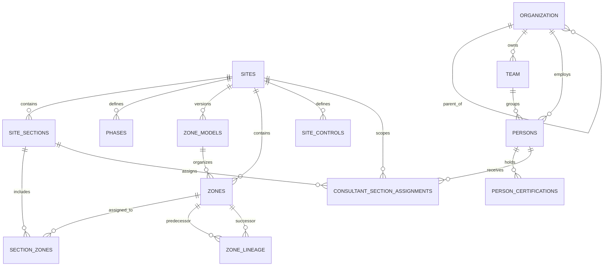
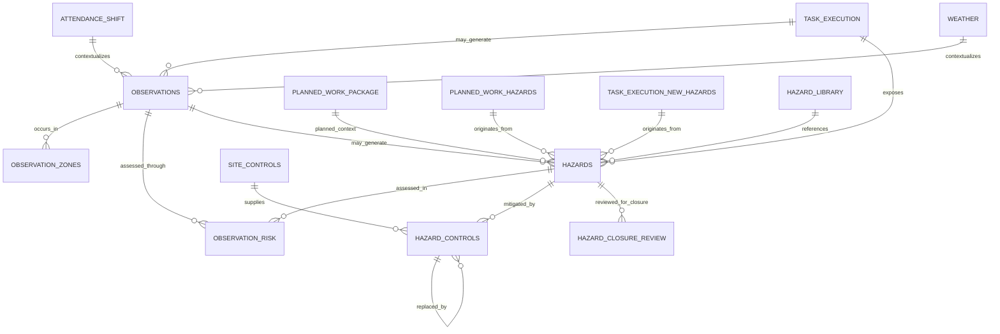
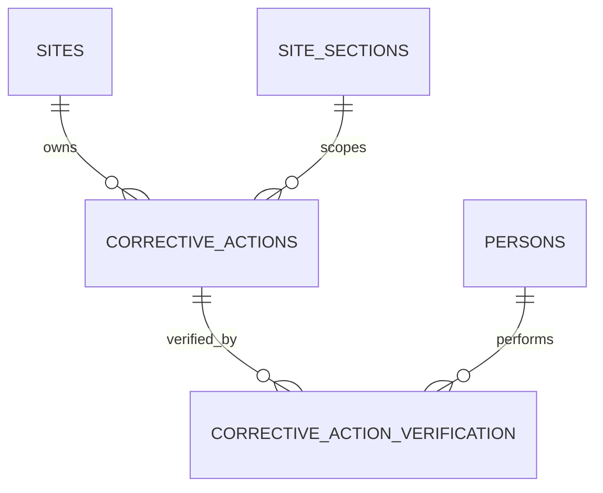
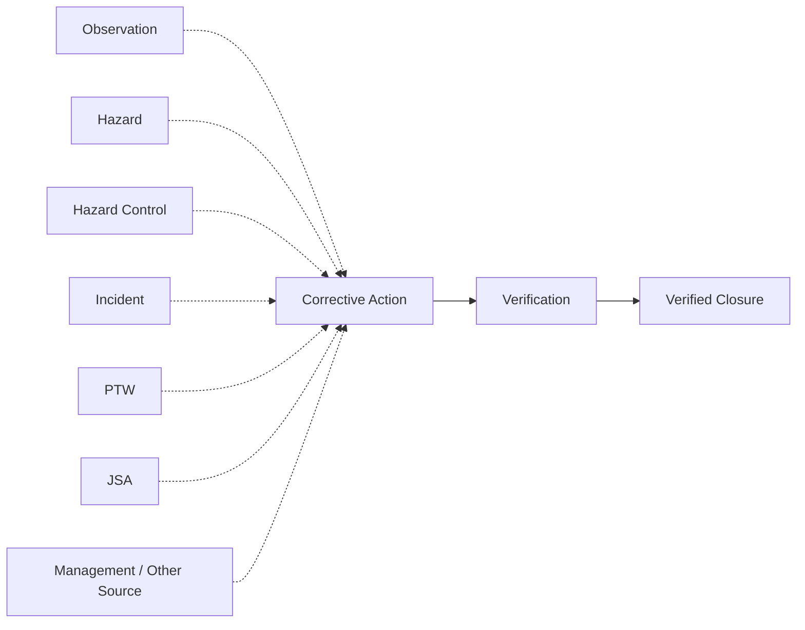
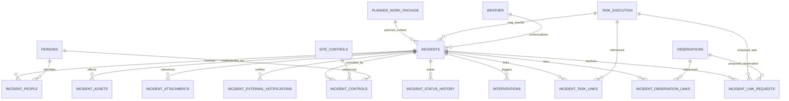
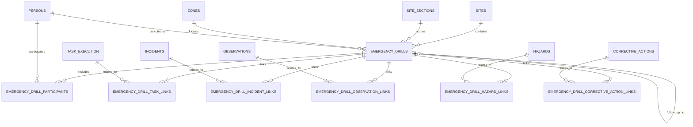
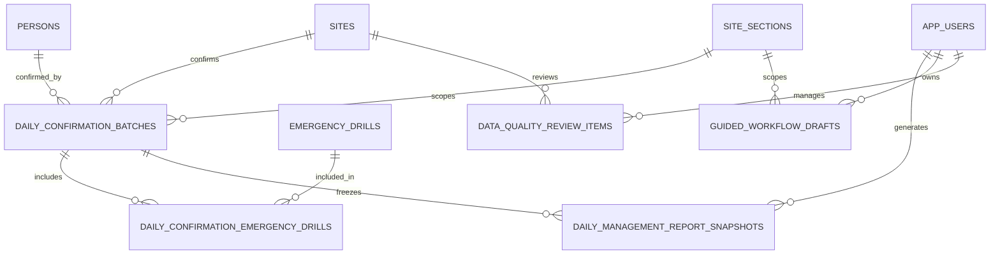
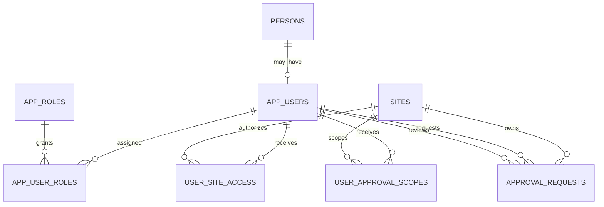
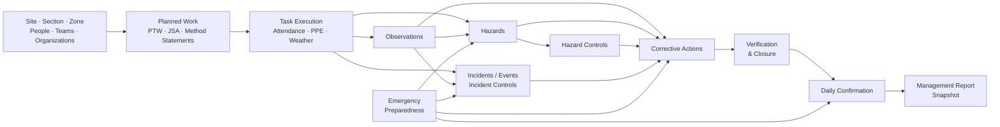

# 🗄️ HSE Risk Intelligence — Database ERD

## Version 1 Physical Data Model

This document provides a technical view of the PostgreSQL data model supporting **HSE Risk Intelligence Version 1**.

The public README presents a simplified operational flow:

**Foundation → Planning & Field Operations → Risk Detection → Incident Response → Follow-Up & Assurance → Confirmation & Management**

This document goes one level deeper and shows how the principal database entities are physically related.

---

## 🧭 Diagram Conventions

The database is intentionally shown as **several domain ERDs rather than one giant diagram**.

That keeps the relationships readable while still showing the underlying implementation.

### Relationship interpretation

The Mermaid ERDs below primarily show **foreign-key relationships enforced by PostgreSQL**.

Some application relationships are intentionally handled differently:

- some tables contain contextual IDs without a database-level foreign-key constraint
- Corrective Actions use a **polymorphic source model**
- some operational relationships are represented through dedicated link tables
- lookup/reference tables are omitted where they would make the diagrams unnecessarily dense

These implementation details are explained beneath the relevant diagrams.

---

# 1 · Operational Foundation

The `core` schema provides the structural context used across operational workflows.



### Principal entities

| Entity | Purpose |
|---|---|
| `core.sites` | Top-level operational site |
| `core.site_sections` | Operational subdivisions within a site |
| `core.zones` | Physical or operational areas |
| `core.zone_models` | Versioned grouping of zone layouts |
| `core.zone_lineage` | Historical predecessor/successor relationships between zones |
| `core.phases` | Project or operational phases |
| `core.organization` | Employers, contractors, consultants, or other organizations |
| `core.team` | Operational teams belonging to organizations |
| `core.persons` | Personnel records |
| `core.person_certifications` | Certifications associated with personnel |
| `core.site_controls` | Site-level control catalogue |
| `core.consultant_section_assignments` | Personnel/site/section scope assignments |

### Why zone lineage exists

Operational sites change over time.

A zone may:

- expand
- shrink
- split
- merge
- be replaced

`zone_models` and `zone_lineage` allow future operational records to remain interpretable against the physical structure that existed when those records were created.

---

# 2 · Planning & Field Operations

The planning architecture distinguishes **intended work** from **actual execution**.

```mermaid
erDiagram

    TASK_TEMPLATE ||--o{ PLANNED_WORK_PACKAGE : templates
    PHASES ||--o{ PLANNED_WORK_PACKAGE : scopes
    ZONES ||--o{ PLANNED_WORK_PACKAGE : locates

    PLANNED_WORK_PACKAGE ||--o{ PLANNED_WORK_TASK : contains
    TASK_TEMPLATE ||--o{ PLANNED_WORK_TASK : defines
    PHASES ||--o{ PLANNED_WORK_TASK : phases
    ZONES ||--o{ PLANNED_WORK_TASK : locates

    PLANNED_WORK_PACKAGE ||--o{ PLANNED_WORK_HAZARDS : anticipates
    PLANNED_WORK_HAZARDS ||--o{ PLANNED_WORK_CONTROLS : controlled_by
    SITE_CONTROLS ||--o{ PLANNED_WORK_CONTROLS : uses

    PLANNED_WORK_PACKAGE ||--o{ PLANNED_WORK_CONDITIONS : expects

    PLANNED_WORK_PACKAGE ||--o{ PLANNED_WORK_PTWS : links
    PTW ||--o{ PLANNED_WORK_PTWS : selected

    PLANNED_WORK_PACKAGE ||--o{ PLANNED_WORK_JSAS : links
    JSA ||--o{ PLANNED_WORK_JSAS : selected

    PLANNED_WORK_PACKAGE ||--o{ PLANNED_WORK_METHOD_STATEMENTS : links
    METHOD_STATEMENTS ||--o{ PLANNED_WORK_METHOD_STATEMENTS : selected

    TASK_TEMPLATE ||--o{ TASK_EXECUTION : instantiated_as
    WEATHER ||--o{ TASK_EXECUTION : contextualizes

    TASK_EXECUTION ||--o{ TASK_CONDITIONS : records
    TASK_EXECUTION ||--o{ TASK_EXECUTION_CONDITION_CHANGES : detects
    PLANNED_WORK_PACKAGE ||--o{ TASK_EXECUTION_CONDITION_CHANGES : compares_to

    TASK_EXECUTION ||--o{ TASK_EXECUTION_CONTROL_VERIFICATION : verifies
    PLANNED_WORK_PACKAGE ||--o{ TASK_EXECUTION_CONTROL_VERIFICATION : references
    PLANNED_WORK_HAZARDS ||--o{ TASK_EXECUTION_CONTROL_VERIFICATION : checks
    PLANNED_WORK_CONTROLS ||--o{ TASK_EXECUTION_CONTROL_VERIFICATION : checks
    SITE_CONTROLS ||--o{ TASK_EXECUTION_CONTROL_VERIFICATION : verifies

    TASK_EXECUTION ||--o{ TASK_EXECUTION_NEW_HAZARDS : discovers
    PLANNED_WORK_PACKAGE ||--o{ TASK_EXECUTION_NEW_HAZARDS : compares_to

    ATTENDANCE_SHIFT ||--o{ ATTENDANCE_PERSONNEL : contains
    TASK_EXECUTION ||--o{ ATTENDANCE_PERSONNEL : supports

    ATTENDANCE_SHIFT ||--o{ PPE_CHECK : records
    TASK_EXECUTION ||--o{ PPE_CHECK : relates_to
    PPE_CHECK ||--o{ PPE_CHECK_ITEM : contains

    TOOLBOX_MEETINGS ||--o{ TOOLBOX_ATTENDEES : attended_by
    PERSONS ||--o{ TOOLBOX_ATTENDEES : attends

    TOOLBOX_MEETINGS ||--o{ TOOLBOX_MEETING_TASKS : discusses
    TASK_EXECUTION ||--o{ TOOLBOX_MEETING_TASKS : referenced

    TOOLBOX_MEETINGS ||--o{ TOOLBOX_MEETING_PLANNED_WORK : discusses
    PLANNED_WORK_PACKAGE ||--o{ TOOLBOX_MEETING_PLANNED_WORK : referenced

    TOOLBOX_MEETINGS ||--o{ TOOLBOX_MEETING_TOPICS : covers
```



## Planned Work vs Task Execution

This is one of the most important Version 1 distinctions.

### `planned_work_package`

Represents the intended or reusable scope of work.

It may include:

- task template
- zone
- phase
- hazards
- controls
- expected conditions
- PTWs
- JSAs
- Method Statements

### `task_execution`

Represents an **actual dated instance of field work**.

The execution layer then records what was actually encountered, including:

- operational conditions
- changed conditions
- control verification
- newly identified hazards
- weather
- attendance/PPE context
- later observations and incidents

This allows the application to compare:

> **What was planned**

with:

> **What actually occurred**

---

## Planning-document relationships

Version 1 contains both:

- direct planning-document reference columns on `planned_work_package`
- many-to-many link tables such as `planned_work_ptws`, `planned_work_jsas`, and `planned_work_method_statements`

The link-table architecture supports the more flexible model where multiple documents can support one Planned Work Package.

---

# 3 · Observations, Hazards & Controls

This domain captures operational risk evidence and assurance activity.



## Observation design

An Observation does **not** have to belong to a task.

Where applicable it can be related to:

- task execution
- attendance shift
- weather
- zones
- hazards

This prevents the database from inventing task relationships simply to satisfy a rigid schema.

---

## Hazard provenance

The hazard architecture can preserve where a hazard came from.

A hazard may relate to:

- actual task execution
- an observation
- a Planned Work Package
- a planned hazard
- a newly identified execution hazard
- the reusable hazard library

This allows the system to distinguish between:

> a hazard known before work

and:

> a hazard identified during execution.

---

## Hazard controls

`operations.hazard_controls` associates actual hazard records with controls from the site control catalogue.

The relationship can record:

- control status
- effectiveness
- notes
- shift
- replacement relationships

A control being present in the database is therefore not automatically equivalent to that control being effective.

---

# 4 · Corrective Action & Verification

Corrective Actions use a deliberately flexible source architecture.



## Polymorphic source relationship

`corrective_actions` stores:

```text
source_type_id
source_id
```

The source type identifies what kind of operational record generated the action.

Supported Version 1 source categories include:

- Incident
- Hazard
- Observation
- Audit
- Inspection
- PTW
- JSA
- Environmental
- Quality
- Management
- Hazard Control

Conceptually:



The dotted relationships above are **logical application relationships**, not individual PostgreSQL foreign keys from `source_id`.

This polymorphic design allows one Corrective Action table to support multiple operational source types without maintaining many nullable source columns.

---

# 5 · Incident / Event Architecture

Incidents are designed as standalone events that can later accumulate operational relationships.



## Standalone event principle

Incident capture is intentionally **not dependent on first creating a Hazard or Control**.

The initial event can be recorded immediately.

Relationships may then be added to:

- tasks
- observations
- people
- assets
- weather
- controls
- supporting files
- external notifications

This reflects the fact that full causal and operational context may not be known at the moment an incident is first reported.

---

## Incident controls vs hazard controls

Version 1 distinguishes:

### Hazard Controls
Controls associated with an identified ongoing hazard.

### Incident Controls
Measures associated specifically with an incident or its immediate response.

This prevents immediate event-response actions from being confused with persistent operational hazard controls.

---

## Link requests

`incident_link_requests` supports controlled linking when a Task Execution or Observation may be related to an Incident but that relationship should not be silently created.

A request can be:

- Pending
- Linked
- Dismissed

This allows linkage decisions to remain reviewable.

---

# 6 · Emergency Preparedness

Emergency Drills form a cross-domain preparedness structure.



## Why Emergency Drills are cross-domain

A drill may reveal information relevant to:

- an operational task
- a previously recorded incident
- an observation
- a hazard
- a corrective action

The drill architecture therefore does not isolate preparedness from the rest of the operational record.

It allows lessons learned during preparedness activities to become part of the same traceable improvement lifecycle.

---

# 7 · Confirmation, Reporting & Workflow State

Daily confirmation separates unfinished operational data from the formally confirmed record.



## Daily confirmation batch

`daily_confirmation_batches` establishes the final confirmed state for a:

```text
Site
+ Work Date
+ Section
```

Important fields include:

- confirmation batch key
- confirmer
- confirmation timestamp
- lock status
- override state/reason

Once confirmed, the batch provides the boundary between:

> unfinished or editable workflow state

and:

> the formally confirmed daily operational record.

---

## Immutable management-report snapshot

`daily_management_report_snapshots` stores the final report text against the confirmation batch.

This allows the application to retrieve:

> **the report that was actually confirmed**

rather than reconstructing a historical report later from tables that may have subsequently changed.

---

## Guided workflow drafts

`guided_workflow_drafts` stores in-progress Streamlit workflow state.

Draft state and confirmed operational state remain separate.

This supports:

- incomplete workflow recovery
- multi-step guided entry
- protection against treating unfinished information as confirmed evidence

---

# 8 · Security & Approval Architecture

Application identity is separated from operational personnel identity.



## Why `persons` and `app_users` are separate

A person may exist operationally without having permission to use the application.

For example:

- worker
- contractor
- visitor
- drill participant

may exist in `core.persons`.

Only users who need application access require a `security.app_users` record.

This separates:

> **Who exists operationally**

from:

> **Who is authorized to use or approve things in the application.**

---

## Approval requests

`operations.approval_requests` supports management-governed actions without allowing the requesting user to silently make the final decision.

The model retains:

- requesting user
- requested status/change
- reason
- approval state
- reviewing user
- review date
- review note

The schema also prevents the requester from being the reviewer of the same request.

---

# 9 · Analytics Layer

Version 1 includes:

```text
analytics.daily_kpis
```

as an analytics-ready structure.

The physical operational model has deliberately been developed before a large analytics layer.

This means future analysis can derive measures from structured source records rather than forcing operational workflows to conform to dashboard requirements.

Potential future analytical dimensions include:

- task/work type
- site
- section
- zone
- organization
- team
- hazard category
- control effectiveness
- observations
- incidents
- corrective-action ageing
- preparedness activity
- longitudinal trends

The existence of the analytics schema should **not** be interpreted as a claim that Version 1 already contains a mature predictive analytics engine.

---

# 🔗 Cross-Domain Operational Chain

Taken together, the Version 1 physical architecture supports a broader information chain:



This diagram represents the **operational meaning of the database**, while the individual ERDs above show the physical implementation in greater detail.

---

# ⚠️ Important Implementation Notes

## 1. Not every stored ID is currently an enforced foreign key

The frozen Version 1 schema contains several contextual ID columns whose relationships are managed by application logic rather than PostgreSQL constraints.

For example, `task_execution` stores operational context including identifiers such as:

- site
- section
- team
- zone
- phase
- planned work

but not every one of those relationships is enforced by a physical FK in the frozen baseline.

For this document:

> **A relationship is not presented as a physical FK merely because two columns appear logically related.**

This distinction is important when reviewing data integrity.

---

## 2. Corrective Actions are polymorphic

`corrective_actions.source_id` does not have separate foreign keys to every possible source table.

The associated `source_type_id` determines how the application interprets `source_id`.

This is why the Corrective Action source flow is shown separately as a **logical relationship model**.

---

## 3. Link tables preserve many-to-many relationships

Dedicated linking tables are used where a single operational record may legitimately relate to multiple other records.

Examples include:

- incident ↔ task
- incident ↔ observation
- drill ↔ task
- drill ↔ incident
- drill ↔ observation
- drill ↔ hazard
- drill ↔ corrective action
- planned work ↔ PTW
- planned work ↔ JSA
- planned work ↔ Method Statement

This preserves traceability without forcing one-to-one relationships where the operational reality is more complex.

---

## 4. Lookup tables are intentionally abbreviated here

The PostgreSQL database contains many controlled lookup tables covering areas such as:

- statuses
- incident types/subtypes
- severity
- probability
- shifts
- control effectiveness
- task categories/types
- source types
- emergency drill types/statuses
- approval classifications

Showing all lookup-table relationships in every diagram would significantly reduce readability.

They remain part of the physical database even where they are not drawn above.

---

# 🔭 Version 2 Boundary

The Version 1 ERD intentionally does **not** include unimplemented future concepts such as:

- Bowtie threat/barrier/consequence entities
- barrier-health engines
- predictive risk engines
- scenario-simulation engines
- AI query layers

Those remain possible **Version 2 research directions**.

They should only be added to the physical ERD after they exist as implemented and tested database/application structures.

---

# 🧠 Architecture Summary

The Version 1 database is best understood as six connected operational domains:

1. **Foundation**  
   Sites, sections, zones, organizations, teams, and personnel.

2. **Planning & Execution**  
   Planned Work Packages, planning documents, attendance, toolbox activity, task execution, weather, conditions, and control verification.

3. **Risk & Assurance**  
   Observations, hazards, controls, corrective actions, and verification.

4. **Incident Management**  
   Events, people/assets, controls, operational links, lifecycle history, and follow-up.

5. **Preparedness**  
   Emergency drills and their relationships to operational evidence.

6. **Governance & Reporting**  
   Application identity, approvals, daily confirmation, immutable management-report snapshots, data-quality review, and analytics-ready structures.

Together they form a relational foundation for **human-guided operational HSE decision support** rather than an automated safety-decision engine.
