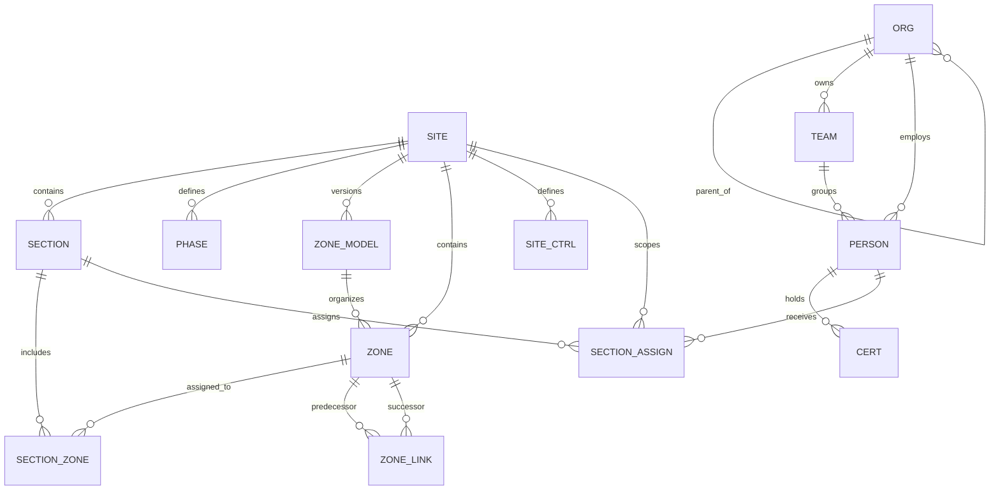
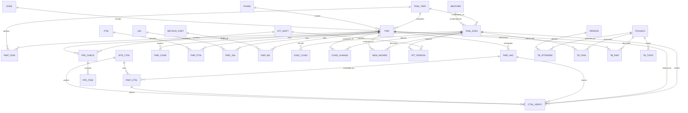
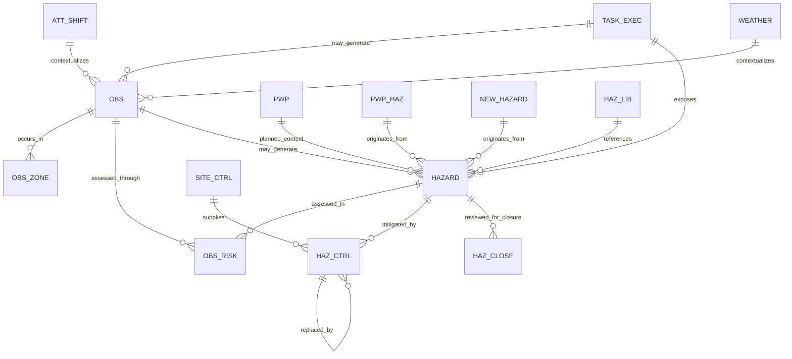
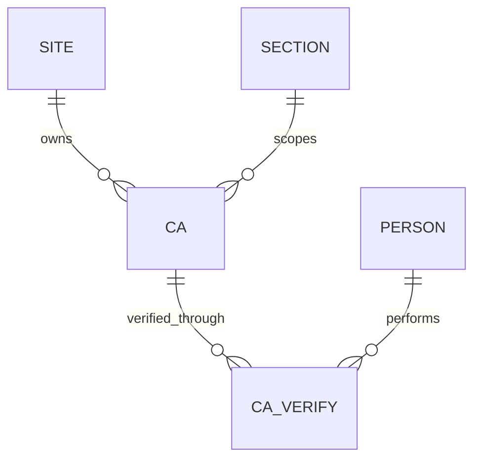
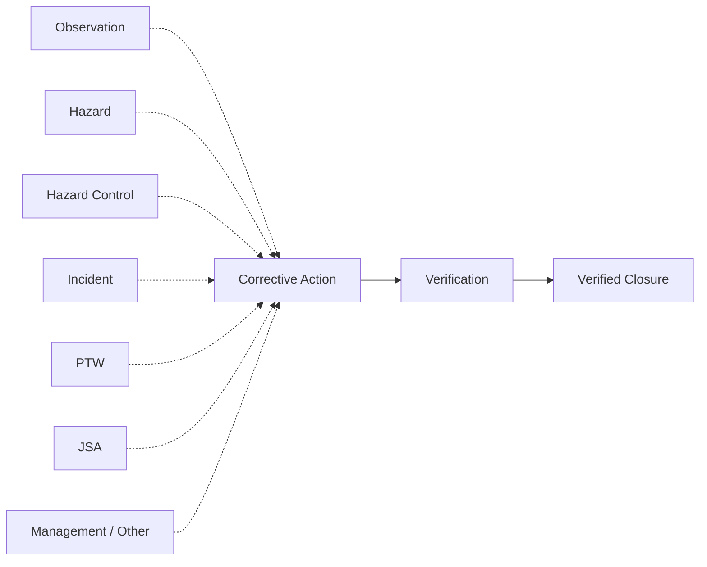
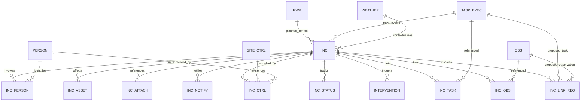
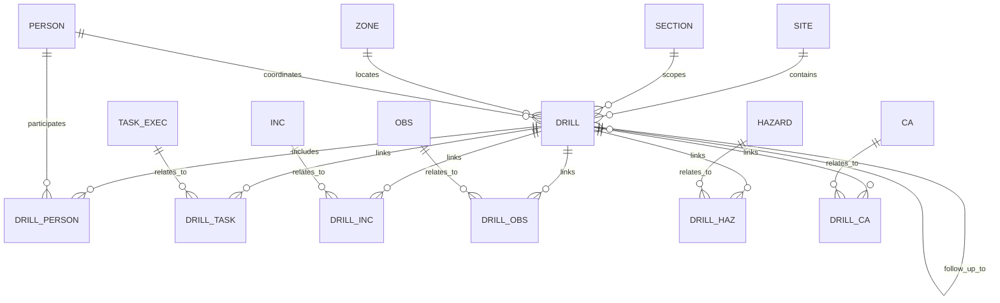
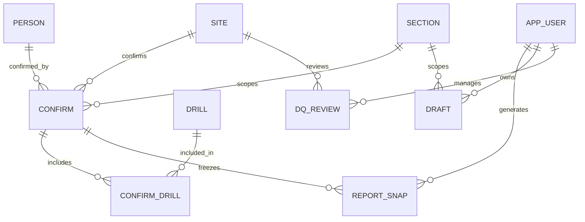
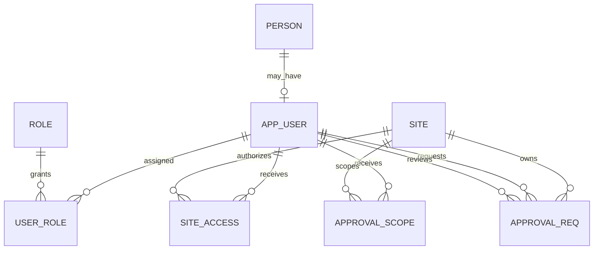
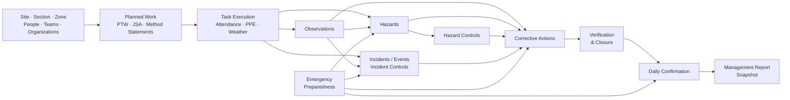

# 🗄️ HSE Risk Intelligence — Database ERD

## Version 1 Physical Data Model

This document provides a technical view of the PostgreSQL data model supporting **HSE Risk Intelligence Version 1**.

The public README presents the simplified operational flow:

**Foundation → Planning & Field Operations → Risk Detection → Incident Response → Follow-Up & Assurance → Confirmation & Management**

This document goes one level deeper into the principal database entities and relationships.

---

## 🧭 Diagram Conventions

The database is shown as **multiple domain ERDs rather than one giant diagram**.

This keeps a complex schema readable.

Short entity names are intentionally used inside the Mermaid diagrams to prevent labels from being truncated by GitHub.

The exact PostgreSQL table represented by each short name is listed immediately beneath each diagram.

Lookup/reference tables are generally omitted unless they materially help explain the architecture.

---

# 1 · Operational Foundation



### Physical table mapping

| Diagram | PostgreSQL table |
|---|---|
| `SITE` | `core.sites` |
| `SECTION` | `core.site_sections` |
| `PHASE` | `core.phases` |
| `ZONE_MODEL` | `core.zone_models` |
| `ZONE` | `core.zones` |
| `SITE_CTRL` | `core.site_controls` |
| `SECTION_ZONE` | section/zone relationship structure |
| `ZONE_LINK` | `core.zone_lineage` |
| `ORG` | organization table |
| `TEAM` | team table |
| `PERSON` | `core.persons` |
| `CERT` | `core.person_certifications` |
| `SECTION_ASSIGN` | `core.consultant_section_assignments` |

Zone models and lineage help preserve historical interpretation when site zones change over time.

---

# 2 · Planning & Field Operations



### Physical table mapping

| Diagram | PostgreSQL table / concept |
|---|---|
| `TASK_TMPL` | `operations.task_template` |
| `PWP` | `operations.planned_work_package` |
| `PWP_TASK` | planned-work task relationship |
| `PWP_HAZ` | planned-work hazard |
| `PWP_CTRL` | planned-work control |
| `PWP_COND` | planned-work condition |
| `PWP_PTW` | planned-work ↔ PTW link |
| `PWP_JSA` | planned-work ↔ JSA link |
| `PWP_MS` | planned-work ↔ Method Statement link |
| `PTW` | `operations.ptw` |
| `JSA` | `operations.jsa` |
| `METHOD_STMT` | `operations.method_statements` |
| `TASK_EXEC` | `operations.task_execution` |
| `WEATHER` | `operations.weather` |
| `EXEC_COND` | execution-condition records |
| `COND_CHANGE` | `operations.task_execution_condition_changes` |
| `CTRL_VERIFY` | `operations.task_execution_control_verification` |
| `NEW_HAZARD` | `operations.task_execution_new_hazards` |
| `ATT_SHIFT` | `operations.attendance_shift` |
| `ATT_PERSON` | attendance-personnel relationship |
| `PPE_CHECK` | PPE verification/check structure |
| `PPE_ITEM` | individual PPE-check items |
| `TOOLBOX` | toolbox meeting |
| `TB_ATTENDEE` | toolbox participation |
| `TB_TASK` | toolbox ↔ task relationship |
| `TB_PWP` | toolbox ↔ planned-work relationship |
| `TB_TOPIC` | toolbox topic relationship |

### Planned vs actual work

A `PWP` represents **intended/reusable work scope**.

A `TASK_EXEC` represents an **actual dated field-work instance**.

This distinction allows the platform to compare:

> **What was planned**

with:

> **What actually occurred**

---

# 3 · Observations, Hazards & Controls



### Physical table mapping

| Diagram | PostgreSQL table |
|---|---|
| `TASK_EXEC` | `operations.task_execution` |
| `ATT_SHIFT` | `operations.attendance_shift` |
| `WEATHER` | `operations.weather` |
| `OBS` | `operations.observations` |
| `OBS_ZONE` | observation-zone relationship |
| `OBS_RISK` | `operations.observation_risk` |
| `HAZARD` | `operations.hazards` |
| `PWP` | `operations.planned_work_package` |
| `PWP_HAZ` | planned-work hazard |
| `NEW_HAZARD` | `operations.task_execution_new_hazards` |
| `HAZ_LIB` | `core.hazard_library` |
| `HAZ_CTRL` | `operations.hazard_controls` |
| `SITE_CTRL` | `core.site_controls` |
| `HAZ_CLOSE` | `operations.hazard_closure_review` |

An Observation does not have to belong to a Task Execution.

Where evidence supports the relationship, the system can preserve:

**Task Execution → Observation → Hazard → Control**

Hazards may also originate from planning or be identified for the first time during actual execution.

---

# 4 · Corrective Action & Verification



### Physical table mapping

| Diagram | PostgreSQL table |
|---|---|
| `SITE` | `core.sites` |
| `SECTION` | `core.site_sections` |
| `CA` | `operations.corrective_actions` |
| `CA_VERIFY` | `operations.corrective_action_verification` |
| `PERSON` | `core.persons` |

## Corrective Action source model

Corrective Actions use:

```text
source_type_id
source_id
```

Supported source categories include:

- Incident
- Hazard
- Observation
- Audit
- Inspection
- PTW
- JSA
- Environmental
- Quality
- Management
- Hazard Control

Conceptually:



The dotted lines represent **logical/application relationships**.

`source_id` is not implemented as a separate PostgreSQL FK to every possible source table.

---

# 5 · Incident / Event Architecture



### Physical table mapping

| Diagram | PostgreSQL table |
|---|---|
| `INC` | `operations.incidents` |
| `INC_PERSON` | incident-people table |
| `INC_ASSET` | `operations.incident_assets` |
| `INC_ATTACH` | `operations.incident_attachments` |
| `INC_NOTIFY` | `operations.incident_external_notifications` |
| `INC_CTRL` | `operations.incident_controls` |
| `INC_STATUS` | incident-status-history table |
| `INTERVENTION` | `operations.interventions` |
| `INC_TASK` | `operations.incident_task_links` |
| `INC_OBS` | `operations.incident_observation_links` |
| `INC_LINK_REQ` | `operations.incident_link_requests` |
| `TASK_EXEC` | `operations.task_execution` |
| `OBS` | `operations.observations` |
| `PERSON` | `core.persons` |
| `SITE_CTRL` | `core.site_controls` |
| `WEATHER` | `operations.weather` |
| `PWP` | `operations.planned_work_package` |

Incidents can be recorded before every causal relationship is known.

Operational links can then be added as evidence becomes available.

---

# 6 · Emergency Preparedness



### Physical table mapping

| Diagram | PostgreSQL table |
|---|---|
| `DRILL` | `operations.emergency_drills` |
| `DRILL_PERSON` | `operations.emergency_drill_participants` |
| `DRILL_TASK` | `operations.emergency_drill_task_links` |
| `DRILL_INC` | `operations.emergency_drill_incident_links` |
| `DRILL_OBS` | `operations.emergency_drill_observation_links` |
| `DRILL_HAZ` | `operations.emergency_drill_hazard_links` |
| `DRILL_CA` | `operations.emergency_drill_corrective_action_links` |
| `TASK_EXEC` | `operations.task_execution` |
| `INC` | `operations.incidents` |
| `OBS` | `operations.observations` |
| `HAZARD` | `operations.hazards` |
| `CA` | `operations.corrective_actions` |
| `PERSON` | `core.persons` |
| `SITE` | `core.sites` |
| `SECTION` | `core.site_sections` |
| `ZONE` | `core.zones` |

Emergency preparedness is intentionally connected with the broader operational record rather than isolated as a compliance-only activity.

---

# 7 · Confirmation, Reporting & Workflow State



### Physical table mapping

| Diagram | PostgreSQL table |
|---|---|
| `CONFIRM` | `operations.daily_confirmation_batches` |
| `CONFIRM_DRILL` | `operations.daily_confirmation_emergency_drills` |
| `REPORT_SNAP` | `operations.daily_management_report_snapshots` |
| `DRILL` | `operations.emergency_drills` |
| `DRAFT` | `operations.guided_workflow_drafts` |
| `DQ_REVIEW` | `operations.data_quality_review_items` |
| `APP_USER` | `security.app_users` |
| `SITE` | `core.sites` |
| `SECTION` | `core.site_sections` |
| `PERSON` | `core.persons` |

## Daily confirmation

`CONFIRM` establishes final confirmation for:

**Site + Work Date + Section**

The confirmation record preserves:

- confirmer
- confirmation time
- lock state
- override state
- reason where required

---

## Immutable report snapshot

`REPORT_SNAP` stores the final management-report text associated with the confirmed batch.

Its purpose is to preserve:

> **the report that was actually confirmed**

rather than regenerating historical reports from operational data that may later change.

---

# 8 · Security & Approval Architecture



### Physical table mapping

| Diagram | PostgreSQL table |
|---|---|
| `PERSON` | `core.persons` |
| `APP_USER` | `security.app_users` |
| `ROLE` | `security.app_roles` |
| `USER_ROLE` | `security.app_user_roles` |
| `SITE_ACCESS` | `security.user_site_access` |
| `APPROVAL_SCOPE` | `security.user_approval_scopes` |
| `APPROVAL_REQ` | `operations.approval_requests` |
| `SITE` | `core.sites` |

A person can exist operationally without being an application user.

This separates:

**Who exists in site operations**

from:

**Who is authorized to use or approve actions in the application.**

---

# 9 · Analytics Layer

Version 1 includes:

```text
analytics.daily_kpis
```

as an analytics-ready structure.

The operational data model has deliberately been established before building a large analytics layer.

Potential analytical dimensions include:

- site
- section
- zone
- task/work type
- organization/team
- observations
- hazards
- control effectiveness
- incidents
- corrective-action ageing
- preparedness activity
- longitudinal trends

Version 1 does **not** claim to contain a mature predictive-risk engine.

---

# 🔗 Cross-Domain Operational Chain



This final diagram represents the **operational meaning** of the architecture.

The domain ERDs above provide the more technical implementation view.

---

# ⚠️ Implementation Notes

## 1. Physical vs logical relationships

Not every stored identifier in Version 1 is enforced through a PostgreSQL foreign-key constraint.

Some contextual relationships are maintained through application logic.

The public ERD therefore distinguishes between:

- physical database relationships
- dedicated relationship tables
- logical/application relationships

---

## 2. Corrective Actions use polymorphic sources

`corrective_actions.source_id` may represent different source entities according to `source_type_id`.

This is why the Corrective Action source relationships are shown as a separate conceptual flow instead of pretending that every source has a physical FK.

---

## 3. Relationship tables preserve many-to-many structures

Examples include:

- incident ↔ task
- incident ↔ observation
- drill ↔ task
- drill ↔ incident
- drill ↔ observation
- drill ↔ hazard
- drill ↔ corrective action
- planned work ↔ PTW
- planned work ↔ JSA
- planned work ↔ Method Statement

---

## 4. Lookup tables are intentionally abbreviated

Version 1 contains numerous controlled lookup tables covering:

- statuses
- incident types
- severity
- probability
- shifts
- PPE
- control effectiveness
- task classifications
- source types
- drill categories
- approval classifications

Showing all of them in every diagram would make the ERDs substantially harder to read.

---

# 🔄 ERD Maintenance After Version 1

The frozen Version 1 baseline remains unchanged.

Future migrations do **not** automatically require every public document to be rewritten.

### Migration affects only implementation

Examples:

- new index
- constraint correction
- nullable-field adjustment
- query-performance change

**Documentation impact:** normally none.

### Migration changes physical database structure

Examples:

- new table
- new FK
- new relationship table

**Documentation impact:** update the relevant section of `Database_ERD.md`.

### Migration changes operational workflow

Example:

- new approval lifecycle
- new incident state
- new confirmation behavior

**Documentation impact:**

- relevant section of `Database_ERD.md`
- relevant section of `Database_Operations_Manual.md`
- `HOW_IT_WORKS.md` only if the user-facing workflow changed

### Migration introduces a major new capability

Examples:

- Version 2 Bowtie architecture
- barrier-health analysis
- simulation
- major management workspace

Only then would the wider public materials potentially need updating:

- README
- conceptual Operational Architecture
- GIF
- Case Study
- Portfolio website

This keeps documentation maintenance proportional to the size of the change.

---

# 🔭 Version 2 Boundary

The Version 1 ERD intentionally excludes future concepts such as:

- Bowtie threat/barrier/consequence structures
- barrier-health engines
- predictive risk engines
- scenario simulation
- AI query layers

These should enter the physical ERD only after they are actually implemented and tested.

---

# 🧠 Architecture Summary

Version 1 can be understood through six connected domains:

1. **Foundation** — sites, sections, zones, organizations, teams, and personnel.
2. **Planning & Execution** — planned work, documents, attendance, toolbox activity, task execution, weather, conditions, and control verification.
3. **Risk & Assurance** — observations, hazards, controls, corrective actions, and verification.
4. **Incident Management** — incidents/events, people/assets, controls, operational links, lifecycle and follow-up.
5. **Preparedness** — emergency drills and their operational relationships.
6. **Governance & Reporting** — users, approvals, confirmation, immutable reporting, data-quality review, and analytics-ready structures.

Together these provide the relational foundation for **human-guided operational HSE decision support**.
