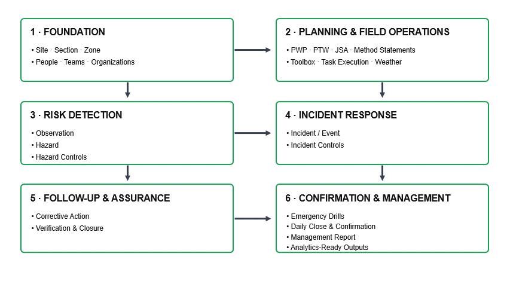
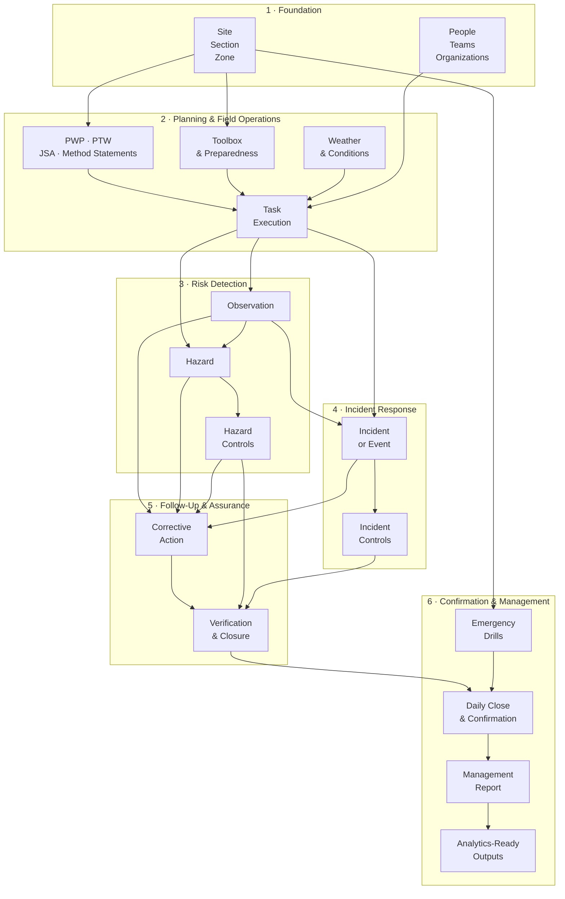

## 🎞️ How the Operational Workflow Connects

---

## 🔄 Conceptual Operational Risk Model

This is a conceptual model. The physical PostgreSQL implementation contains additional relationship, lifecycle, audit, lookup, approval, and history tables.
